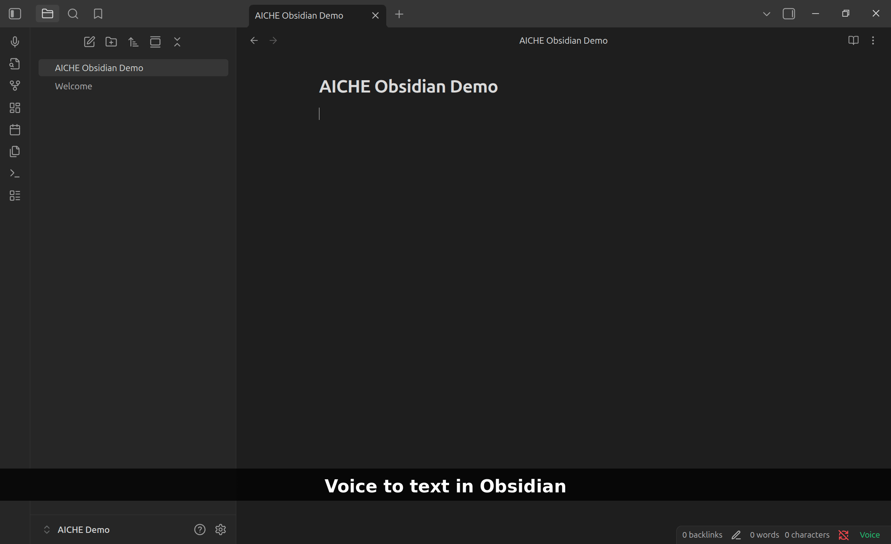
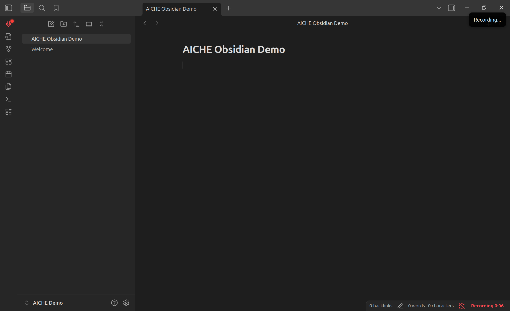
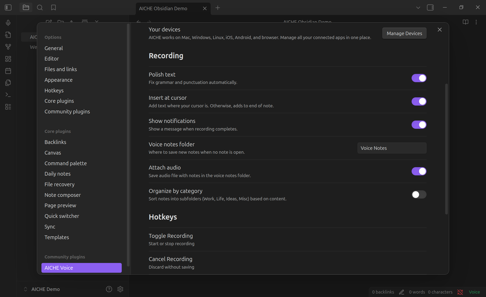

# AICHE Voice for Obsidian

Speak into your notes. Polished text in seconds.

Part of [AICHE](https://aiche.app) - one subscription, voice-to-text everywhere: desktop apps, Obsidian, mobile, browser.

## What It Does

Press record, speak naturally, get clean text with grammar and punctuation handled. Not raw transcription - readable sentences.

- **Live words**: see what you say appear at your cursor while you talk; filler words drop out as the text is cleaned up.
- **Your style**: pick how text comes out - as you said it, tidied up, a formatted note, or a message ready to send.
- **Any language**: speak in any language; keep it, or get English.
- **Desktop and mobile**: a floating mic button, the ribbon, a hotkey, or the command palette.

## Install

**Community Plugins**
1. Settings → Community Plugins → Browse
2. Search "AICHE Voice"
3. Install → Enable

**Manual**
1. Download latest release
2. Extract to `.obsidian/plugins/aiche-voice/`
3. Enable in Community Plugins

## Setup

1. Settings → AICHE Voice → Sign in
2. Authenticate in browser
3. Answer a few setup questions (or skip them)
4. Start recording

## Usage

| Method | Action |
|--------|--------|
| Ribbon | Click microphone icon |
| Hotkey | Settings → Hotkeys → search "AICHE" |
| Command | `Ctrl/Cmd + P` → "Toggle recording" |
| Mic button | Floating button, on by default on mobile |
| Status Bar | Click indicator, right-click for menu |

## Settings

| Option | Description |
|--------|-------------|
| Polish text | Grammar and punctuation cleanup |
| Insert at cursor | Text at cursor vs end of note |
| Live dictation | Show words while you speak |
| Notifications | Show completion notices |
| Voice notes folder | Auto-created notes location |
| Attach audio | Embed audio with voice notes |
| Category folders | Organize into Work/Life/Ideas/Misc |

## Requirements

- **Account**: an AICHE account is required. Sign-in happens on aiche.app in your browser.
- **Payment**: a paid AICHE subscription is required after the 7-day free trial.
- **Network**: the plugin needs an internet connection and talks only to AICHE:
  - `https://api.aiche.app` - sign-in, account and subscription status, uploading recordings for transcription, and text cleanup.
  - `wss://api.aiche.app` - streams the microphone while you record, only when live dictation is on, to show your words as you speak.
  - `https://aiche.app` - opened in your browser for sign-in, account, help, Terms and Privacy Policy.
- **Device info**: at sign-in the plugin sends a random device ID it creates, the platform (for example macOS or Android) and the plugin version, so you can see and manage connected devices in your account.
- The plugin reads and writes only inside your vault. It has no ads and no client-side telemetry.

## Privacy

Audio sent to AICHE servers, deleted immediately after transcription. Zero retention.

- Audio: processed and purged (not stored)
- Text: stored with your account
- Offline: encrypted locally (AES-GCM), deleted after upload

[Privacy Policy](https://aiche.app/privacy)

## Pricing

One AICHE subscription works everywhere - desktop, Obsidian, mobile, browser.

7-day free trial. Plans start at $4.99/month.

[Start Free Trial](https://aiche.app)

## Support

- [Website](https://aiche.app)
- [Help](https://aiche.app/help)
- [Issues](https://github.com/AICHE-app/obsidian-aiche-voice/issues)

## License

MIT
